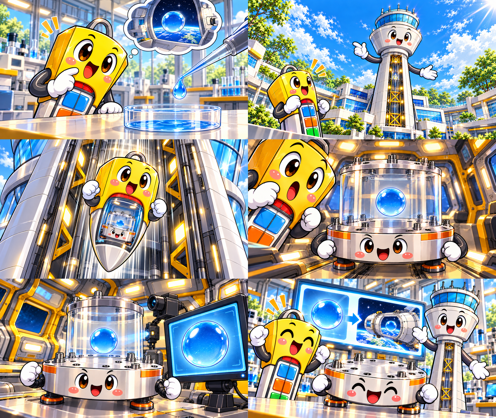

# V3: 장면별 완성 키프레임 — 승인 대기

사용자가 최종 비주얼로 지정한 2번 시안의 6컷을 참고해 장면마다 새로 그렸습니다. 기존 정면 캐릭터 시트나 배경을 반복 배치한 이미지가 아닙니다.

각 파일은 **1920×1080 PNG**입니다. 그림 안에 자막·번호·제목을 넣지 않았습니다. 생성 원본의 비율을 유지해 출력 크기만 정규화했습니다.

| 컷 | 시안과 비교한 주요 요소 | 파일 |
| --- | --- | --- |
| 1 | 기울어진 궁금한 캡슐, 가까운 작업대 원근감, 피펫과 물방울, 물그릇, 우주 생각풍선 | [scene-1.png](./scene-1.png) |
| 2 | 낮은 카메라, 왼쪽 아래의 캡슐, 큰 타워의 내부 통로와 황금색 트러스 | [scene-2.png](./scene-2.png) |
| 3 | 낙하 통로, 큰 캡슐, 창 안에 보이는 플레이트·챔버·물방울, 추진 불꽃 없음 | [scene-3.png](./scene-3.png) |
| 4 | 가장자리의 놀란 반응 얼굴, 앞쪽 플레이트, 겹치는 투명 챔버와 둥근 물방울 | [scene-4.png](./scene-4.png) |
| 5 | 가까운 실험물, 뒤쪽 관측 카메라, 오른쪽 모니터, 불필요한 캡슐 제외 | [scene-5.png](./scene-5.png) |
| 6 | 왼쪽 캡슐, 앞쪽 플레이트, 오른쪽 타워, 큰 뒤쪽 결과 화면과 활기찬 표정 | [scene-6.png](./scene-6.png) |

[키프레임 6장 ZIP 다운로드](./keyframes-1920x1080.zip?raw=true)

## 현재 단계

완성 키프레임 검토 단계입니다. 사용자 승인 이후 이 그림들을 기준으로 깨끗한 배경, 캐릭터, 움직일 소품과 앞쪽 가림 요소를 분리합니다. 아직 분리·재합성 일치 검증을 수행하지 않았으며, 승인 이후 별도로 검증합니다. 눈·입·팔은 실제 움직임이 필요한 범위에서만 분리합니다.

최종 목표는 1920×1080, 30fps, 450프레임(15초)입니다. 현재 단계에서 음성·음악·최종 영상은 제작하지 않았습니다.

V1·V2 소스와 기존 영상은 보존했습니다. V3 작업 이미지: `public/assets/keyframes-v3/`. 해당 폴더의 `generated-originals/`에는 변경하지 않은 생성 원본 및 첫 시도도 남겨두었습니다.
