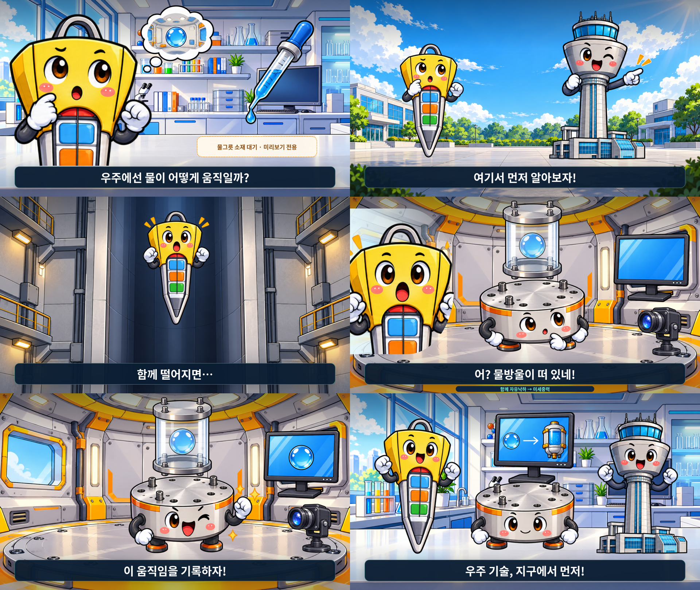

# 수정본 V2: 6장면 미리보기

기존 V1 영상은 상위 폴더 `drop-tower-silent.mp4`에 그대로 보존했습니다.
수정 소스는 `src/webtoon-v2`, Composition은 `DropTowerWebtoonV2`입니다.

상단 장면 번호, 제목, 설명표, 점선 화살표, 낙하 장면 내부 설명창을 제거하고 캐릭터를 확대했습니다.
1920×1080, 30fps, 450프레임 구성을 유지했습니다.

**아직 최종 영상이 아닙니다.** 1컷의 물그릇 원본 소재가 없어 해당 위치에 임시 표시를 넣었습니다.
물그릇 소재 준비 방법이 결정되면 표시를 실제 소재로 교체하고 최종 MP4를 렌더링합니다.

